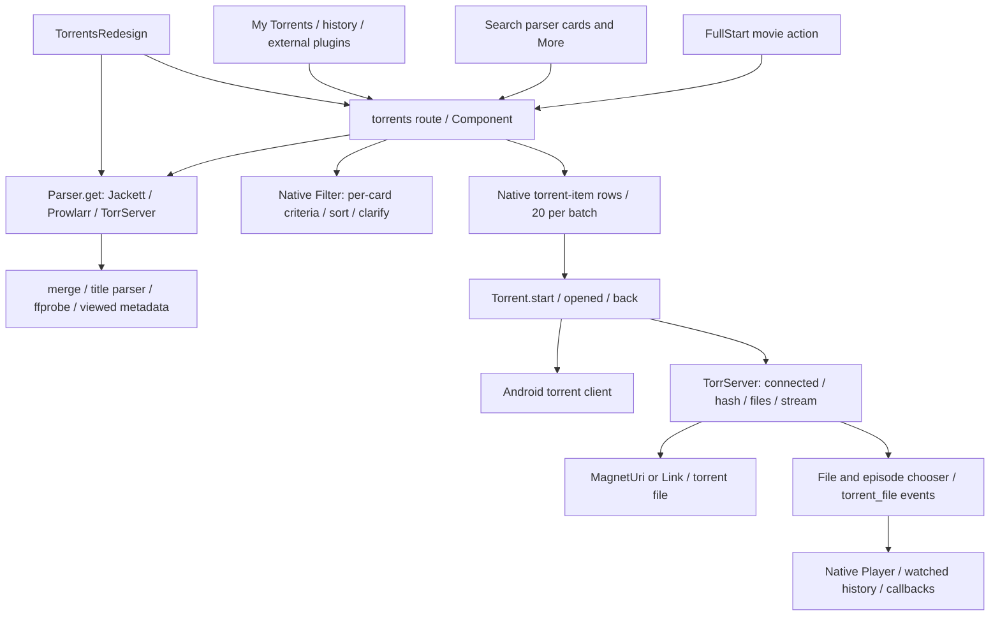

# Embedded movie torrents: dependency map and boundaries

Baseline: branch design/stremio-hybrid-x11, d063d36, Hybrid 2.1.0. Actual native constructor captured from Lampa.Component.get('torrents') in native-component.js; existing local core source audit/home-issues/lampa-app.js used for adjacent modules. Active TorrentsRedesign is 1.1.0 (workspace file is a later 1.2 audit copy; do not replace it as part of this task).

Core owns constructor, parser selection, filter state (`torrents_filter_data`, `torrents_filter`, `torrents_sort`), watched marks/history, pager (20 per batch, at most 15 native pages), long-press actions, Torrent/TorrServer/file/Android/player flow. Parser uses a shared Request; `Parser.clear()` is global. Native component.destroy calls it, so embedded work must be cancelled in the host pause BEFORE another Activity starts its parser.

FullStart action passes movie, original/localized search names, parse_lang combination. Search uses from_search / query; series uses number_of_seasons, episode filters and watched state. These routes cannot all be removed safely by a movie-only theme. Keep the original Component registry and global APIs intact.

TorrentsRedesign decorates only active component=torrents; its full-screen .ctr layout, extra metadata requests, observers, backdrop and native controller are inappropriate inside Full. Embed the original native Component directly without registering a fake torrents Activity; leave the standalone decorator installed and functional for fallback routes. Row `torrent` events and `torrent_file` callbacks still fire through native code; third-party callbacks may inspect the active route, so do not claim universal plugin compatibility.

Cardify/Hybrid movie layout remains owner of backdrop, title, metadata, description, action nodes. Embedded pane is independently scoped on the right. No fake streams, metadata or replacement playback implementation. Native Filter sort/criteria are reused. Advanced query clarification retains a visible compatibility fallback because core Filter.onSearch performs Activity.replace and its global clarification flow cannot safely replace the movie in place.

Stremio X11: current Hope has real Torrentio sources. Right ~24% pane, quality/provider left in each row, release/seeds/size/tracker/language flags right, subdued active/hover background and independent vertical scrolling. hope-hover.png and hope-scrolled.png are actual screenshots; no source was started. Earlier Tenzing empty state is preserved in audit/movie-stremio-first/stremio-tenzing-details.png. No claim of observed stream errors/loading or player return without actual testing.
