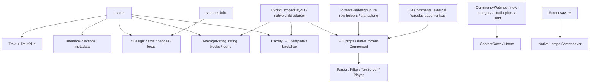

# Full integration: checkpoint audit (2026-10-23)

Working Git repository: `audit/stremio-hybrid-20261022/repository`, branch `design/stremio-hybrid-x11`, HEAD00990ff; tree clean at start. Root workspace is NOT a Git repository. This Git checkout contains the theme/audit package, not a full clone of upstream Lampa: upstream loader/media/community files exist in repository-snapshot and freshly retrieved public copies under this audit's active/ directory. Only deliberately changed files should be imported into the branch.

Publication from previous turn: BLOCKED. HTTPS push failed `could not read Username for https://github.com: No such device or address`; SSH read probe failed host-key verification. No force push, credential reading, host-key bypass, merge or publication. Authorization was granted but does not create authentication.

## Evidence
- Existing CDP tab accessible, Hybrid2.3.0; active TorrentsRedesign1.1.0 (root workspace file1.2 is a separate audit delivery). X11 Stremio ID106954756 accessible.
- state.json contains sanitized origin/path only, no query values, credentials or profile storage. Plugin statuses + actual script elements + Settings category labels recorded. sources.json gives fingerprints of currently served public code; no downloaded code executed.
- Loader sequentially supplies Trakt → Trakt+ → Interface+ → YDesign → AverageRating → Cardify+ → YTranslate. Other paths are direct extensions, including seasons-info, CommunityWatches, providers, Screensaver+, UA Comments and cinema. No duplicate script pathname in current DOM. Local duplicate source files are not evidence of double runtime initialization. Cardify/Interface/YDesign remain needed, with overlapping Full template/style ownership.
- 63 prior PASS retained, not rerun for audit. Hardware/real player/TorrServer transfer remain BLOCKED. Root loopback preview serves only ui/stremio-hybrid.js.

## Dependency map

## Concrete unresolved causes / implementation order
1. Hybrid adaptMovie/scheduleMovie deliberately gate method=movie. Expand the same adapter to TV and animation; use media-aware names/dates/images/cache keys. Preserve existing native episode controls.
2. seasons-info currently creates card progress badges; Full data already exposes seasons/episodes/runtime/next episode. Use the native model, avoid another metadata fetch or duplicate values.
3. AverageRating creates remote icon img without onerror fallback. Inspect Dune broken naturalWidth / key to identify exact icon before fixing.
4. Native torrent Filter.onSearch does Activity.replace. Current Hybrid intercepts it to standalone fallback. Replace ordinary embedded search with native Input and a new child using its own query, including guarded async cleanup; do not monkey-patch global Activity routing. Keep native file/playback modules.
5. CommunityWatches is currently a direct managed extension. Its local served code registers six ContentRows, no separate upstream script element appears in current DOM. Disable only this source per user's explicit instruction after preserving config.
6. new-category owns addCategory Settings and real provider/category rows; not safe to remove before replacement.
7. Screensaver+ overrides S.start but native prototype/start flow may still maintain timers; its own input capture consumes exit keys. Needs measured before/after and reversible native ownership.
8. UA Comments actual source is marv2on/lampa-plugins-sync/sync/Yaroslav/uacoments.js. License/redistribution unresolved: do not vendor until verified.
9. Trakt-first rewrite is deferred until critical Full/source/file fixes stable. Do not read auth storage or merge local Favorite and Trakt Watchlist.

## Direct extensions
| Path | Class | Decision |
|---|---|---|
| http://wtch.ch/m | Потенційно конфліктний | Віддалений провайдер: раніше були load failures; функцію/статус не прирівнюємо до непотрібності. |
| https://lampame.github.io/main/bo.js | Корисний, але потребує оптимізації | Активний native/provider/plugin шлях; не видаляти до перевірки залежностей. |
| http://bwa.ad/rc | Корисний, але потребує оптимізації | Активний native/provider/plugin шлях; не видаляти до перевірки залежностей. |
| https://cub.rip/plugin/lgbt | Потенційно конфліктний | Віддалений провайдер: раніше були load failures; функцію/статус не прирівнюємо до непотрібності. |
| https://lampame.github.io/main/ttv.js | Не використовується | Вимкнений у Extension registry; не видаляється. |
| loader.js | Необхідний | Потрібний для поточної композиції або штатного parsing/playback. |
| media/seasons-info.js | Корисний, але потребує оптимізації | Активний native/provider/plugin шлях; не видаляти до перевірки залежностей. |
| community/community-watches.js | Дублює іншу функціональність | Шість ContentRows CommunityWatches (main/movie/tv × hidden gems/weekly); окремо дозволене вимкнення, не видалено на цьому етапі. |
| community/imdb-trailers.js | Корисний, але потребує оптимізації | Активний native/provider/plugin шлях; не видаляти до перевірки залежностей. |
| community/new-category.js | Корисний, але потребує оптимізації | Активний native/provider/plugin шлях; не видаляти до перевірки залежностей. |
| community/nightingale.js | Корисний, але потребує оптимізації | Активний native/provider/plugin шлях; не видаляти до перевірки залежностей. |
| filters/anti-dmca.js | Корисний, але потребує оптимізації | Активний native/provider/plugin шлях; не видаляти до перевірки залежностей. |
| filters/hide-content.js | Корисний, але потребує оптимізації | Активний native/provider/plugin шлях; не видаляти до перевірки залежностей. |
| filters/lampac-source-filter.js | Корисний, але потребує оптимізації | Активний native/provider/plugin шлях; не видаляти до перевірки залежностей. |
| filters/search-sanitizer.js | Корисний, але потребує оптимізації | Активний native/provider/plugin шлях; не видаляти до перевірки залежностей. |
| filters/source-sort.js | Корисний, але потребує оптимізації | Активний native/provider/plugin шлях; не видаляти до перевірки залежностей. |
| filters/trash-filter.js | Корисний, але потребує оптимізації | Активний native/provider/plugin шлях; не видаляти до перевірки залежностей. |
| media/custom-favorites.js | Корисний, але потребує оптимізації | Активний native/provider/plugin шлях; не видаляти до перевірки залежностей. |
| media/studio-picks.js | Корисний, але потребує оптимізації | Активний native/provider/plugin шлях; не видаляти до перевірки залежностей. |
| providers/parsers.js | Необхідний | Потрібний для поточної композиції або штатного parsing/playback. |
| providers/tmdb-networks.js | Корисний, але потребує оптимізації | Активний native/provider/plugin шлях; не видаляти до перевірки залежностей. |
| providers/ts-tracks.js | Необхідний | Потрібний для поточної композиції або штатного parsing/playback. |
| providers/tryzub-tv.js | Корисний, але потребує оптимізації | Активний native/provider/plugin шлях; не видаляти до перевірки залежностей. |
| ui/buttons-plus.js | Корисний, але потребує оптимізації | Активний native/provider/plugin шлях; не видаляти до перевірки залежностей. |
| ui/menu-hide.js | Корисний, але потребує оптимізації | Активний native/provider/plugin шлях; не видаляти до перевірки залежностей. |
| ui/screensaver-plus.js | Корисний, але потребує оптимізації | Активний native/provider/plugin шлях; не видаляти до перевірки залежностей. |
| ui/tv-status.js | Корисний, але потребує оптимізації | Активний native/provider/plugin шлях; не видаляти до перевірки залежностей. |
| https://marv2on.github.io/lampa-plugins-sync/sync/Yaroslav/uacoments.js | Корисний, але потребує оптимізації | Активний native/provider/plugin шлях; не видаляти до перевірки залежностей. |
| torrents-redesign.js | Необхідний | Потрібний для поточної композиції або штатного parsing/playback. |
| http://127.0.0.1:8766/stremio-hybrid.js | Необхідний | Потрібний для поточної композиції або штатного parsing/playback. |
| https://nrsua.github.io/lampa-nrs/lparty.js | Не використовується | Вимкнений у Extension registry; не видаляється. |
| https://lampame.github.io/main/music.js | Не використовується | Вимкнений у Extension registry; не видаляється. |

Dynamic necessary sources: trakt/trakt.js, trakt/trakt-plus.js, ui/interface-plus.js, ui/design-optimized.js, media/average-rating.js, ui/cardify-plus.js, localization/translate.js. System scripts/vendors and native modules remain required. External BWA/Bandera source logic is unchanged; visual checks remain pending.
