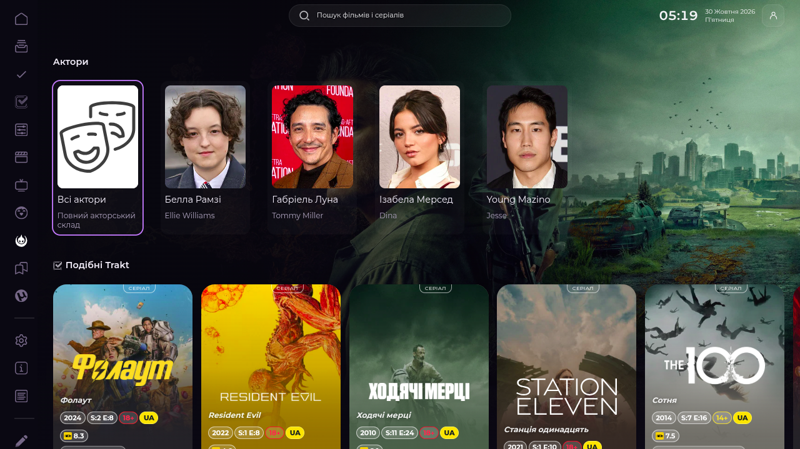
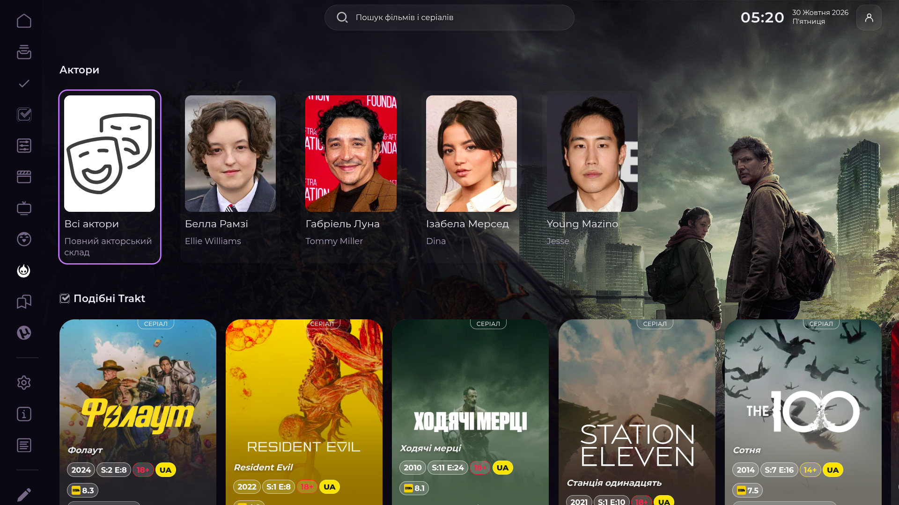
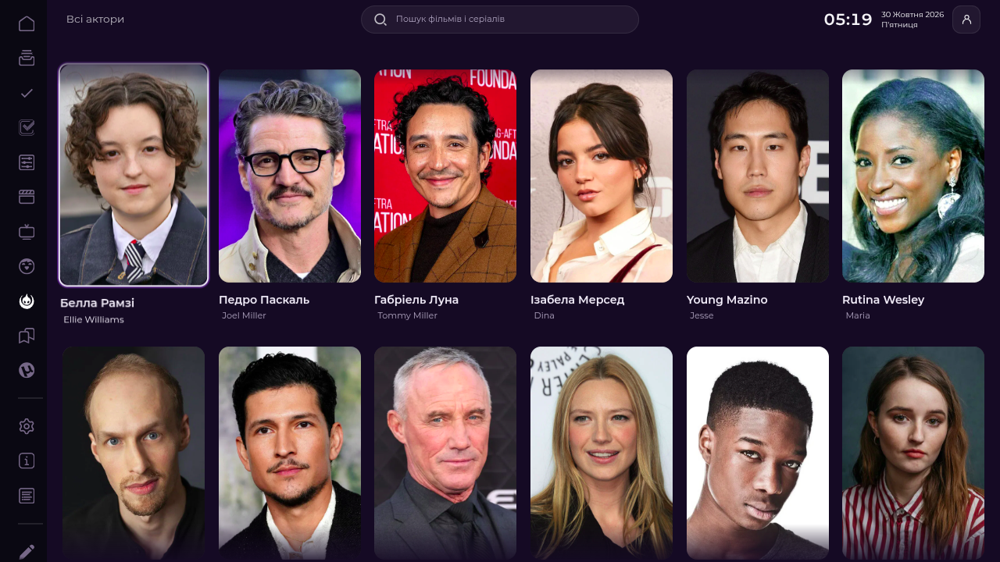
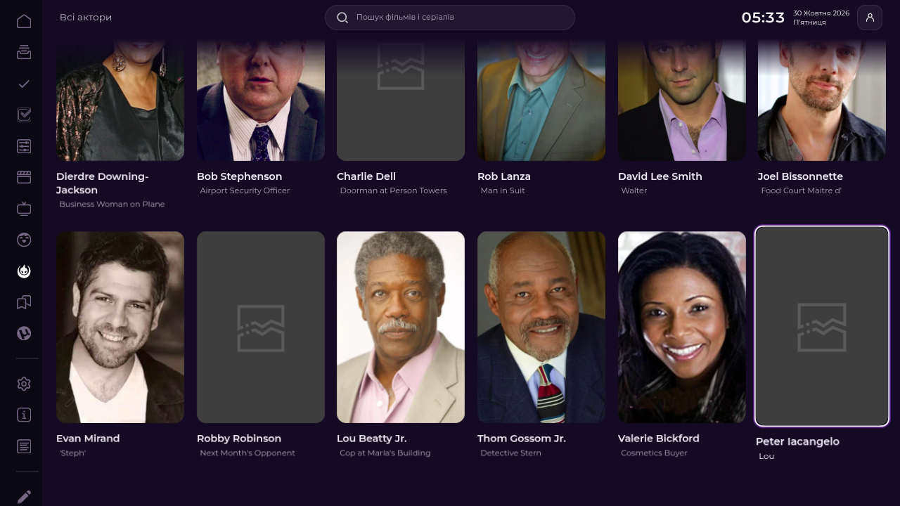
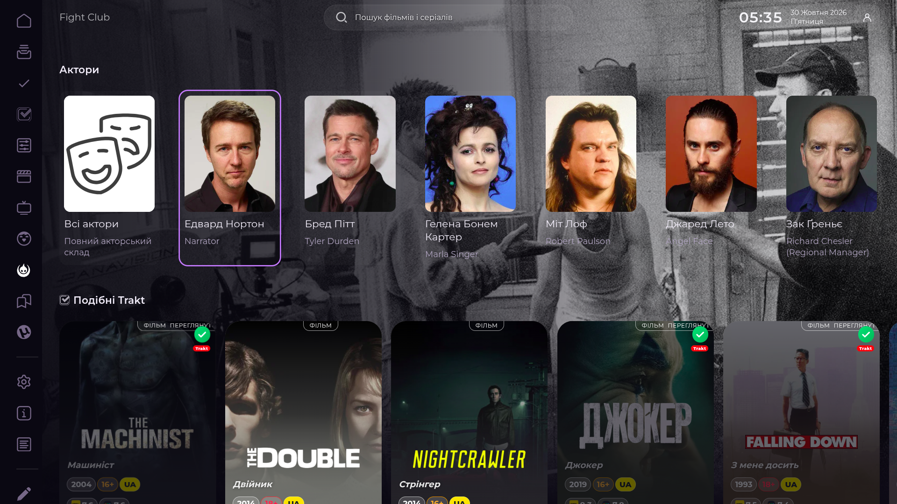
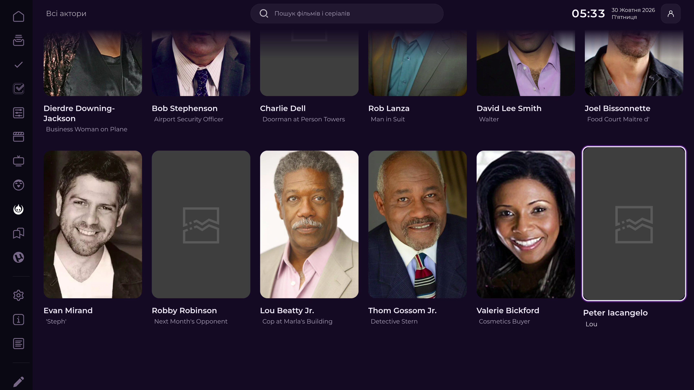
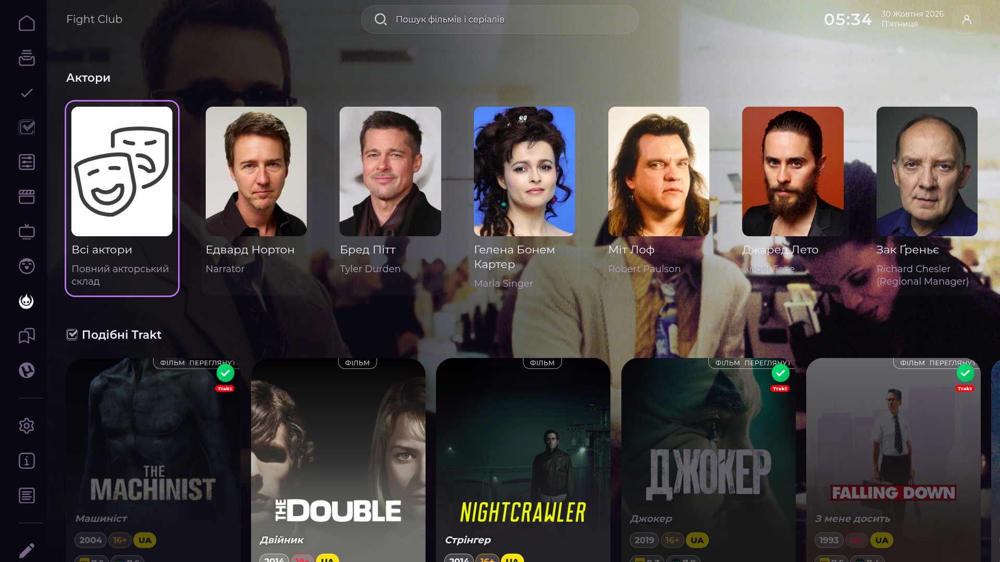

# Issue #87 — Full cast

## Findings and implementation

The Last of Us Details route (`card=100088&media=tv`) initially had four people in native `Full`'s cast row. It was not CSS clipping: the native payload itself contained four entries. The configured TMDb source returned 159 aggregate TV credits for `tv/100088/aggregate_credits`.

The implementation retains native Lampa `Full`, `Person`, and `Category` routes. Details stays synchronous; expanded credits load only when the cast row is built or the user opens the full screen. Requests coalesce and use a bounded 16-title, six-hour cache scoped by `kind:id:tmdb_lang`. No biography, Trakt, or per-person profile requests are made.

The preview preserves the first ten unique credited people, stable TMDb IDs, portraits, credit order, and verified characters/aggregate roles. It adds exactly one native **Всі актори** action as the first item in the existing `Актори` row. Moving Down into that row reaches the action immediately; there is no duplicate heading action or need to traverse the actor carousel. Actor names and role captions use separate card text space; role captions do not cover faces. Equivalent aggregate role captions are deduplicated without merging distinct roles.

The full screen uses the native Lampa `Category`, in pages of 30. Actor Enter opens the native `actor` route. Missing portraits remain in the cast with native fallback artwork. Loading, empty-source, provider-error, retry, and completion states are visible. Retry remains a native Category card action.

The built-in adapter only modifies Details when `StremioHybrid.ownsPresentation('details')` is true. Its CSS registers with the existing Hybrid style owner. It supports a deep-linked `Full` route and delayed Hybrid initialization without modifying the saved plugin list.

## Independent review hardening — 2026-10-30

`replaceCastLine()` now restores focus only when the current Full Activity and Hybrid own the Details screen and the native `items_line` controller currently owns a focused card inside that row. It checks again after the synchronous native row replacement, immediately before `collectionSet` and `collectionFocus`; a new Select/other controller owner prevents focus mutation. Tests resolve pending credits while Select, Torrent Cinema, modal, unrelated Activity, and a controller changed during row replacement are active.

The category pagination metadata reports page 1 on the first batch and page 2 onward accurately. Production-handler tests cover 159 cards in six ordered native batches (30/30/30/30/30/9); the fixture has 158 portrait paths and retains one missing portrait as fallback. The same tests verify loading, empty results, provider failure, reachable retry, and a successful retry.

## Browser acceptance

Used the existing Chrome DevTools Lampa tab (page 3), with the local source served from `http://127.0.0.1:8767/full-cast.js`; the served SHA matched the source at browser capture time (`5f2b0d29413702b66c0f9e6b3a003b8b47e0237dbc06fa3a252008820c41021d`). The final source adds a post-row-replacement controller-owner recheck after that visual/browser pass; that exact race is covered by a production-handler regression. No browser profile, storage, settings, Trakt history, parser configuration, or torrent state was changed.

Live TV case — The Last of Us (`100088`): native TMDb aggregate credits returned 159 people; first Category page rendered 30 cards and 30 image elements. D-pad Down entered the cast row on **Всі актори**, Right focused the first actor, Left returned to the action, and Up/Down moved between adjacent native rows without an Activity transition. Enter opened `sh_full_cast_grid`; Enter on an actor opened native `actor`; Back restored the same actor card; Back restored Details with focus on the originating action.

Live movie case — Fight Club (`550`): native movie credits returned 75 people; the active Category rendered 30 cards and 30 image elements. The visible D-pad path did not invoke the next-page callback in this browser session. A broad page query briefly counted a second, hidden Activity's 30 cards; those were not additional cards in the active Category. Enter opened a person; Back restored the exact person card, and Back returned to movie Details. Screenshots show focus rings, names, roles, missing-photo fallback, and responsive card layout.

The active live Category remained at 30 cards; cumulative live DOM/image growth after 120 cards is **NOT VERIFIED**. The 159-card six-batch result is deterministic production-handler evidence, not a claim that 159 DOM nodes were observed in Chrome. Physical Google TV remains **NOT VERIFIED**.

### Screenshots

Earlier before/after captures are retained here:

| State | 1280×720 | 1920×1080 |
| --- | --- | --- |
| Before (native four-person payload) |  |  |
| After (cast preview) |  |  |

Final review pass (DPR 1):

| View | 1280×720 | 1920×1080 | 3840×2160 |
| --- | --- | --- | --- |
| The Last of Us — focused full-cast action |  |  | — |
| The Last of Us — focused actor card |  |  |  |
| Fight Club — focused native card |  |  |  |
| Fight Club — focused cast action | — |  | — |

The 4K screenshots are desktop viewport emulation at DPR 1. They are not physical television acceptance.

## Automated coverage

`tests/full-cast.cjs` covers actual production handlers: source order and IDs, duplicate people/roles, TV and movie credits, voice roles, missing portraits, small casts, deep-link recovery, Hybrid disabled/delayed ownership, language cache partitioning, controller ownership races, retry/empty/loading states, actor routes, and six-page 159-person pagination. `tests/loader-critical-parallel.cjs` verifies built-in deferred adapter ordering without modifying user preferences.

Focused command:

```sh
node --test --test-timeout=15000 tests/full-cast.cjs tests/loader-critical-parallel.cjs
```

Latest local result: 28/28 passed. Repository checks passed. Final GitHub Actions status and exact pushed SHA are recorded in the PR after final push.
