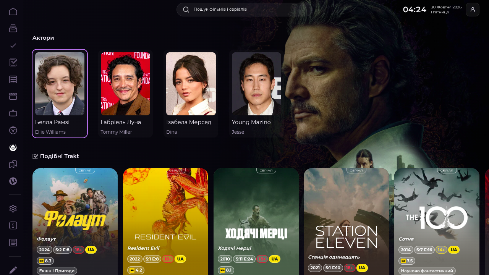
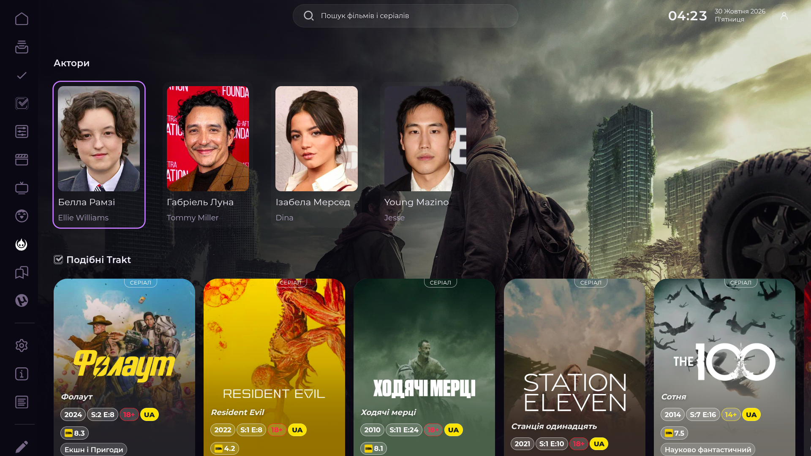
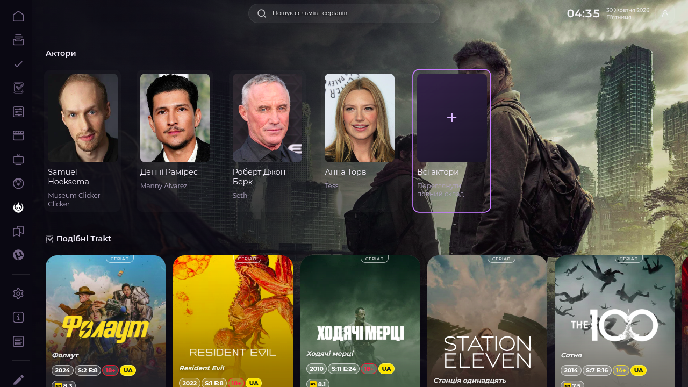
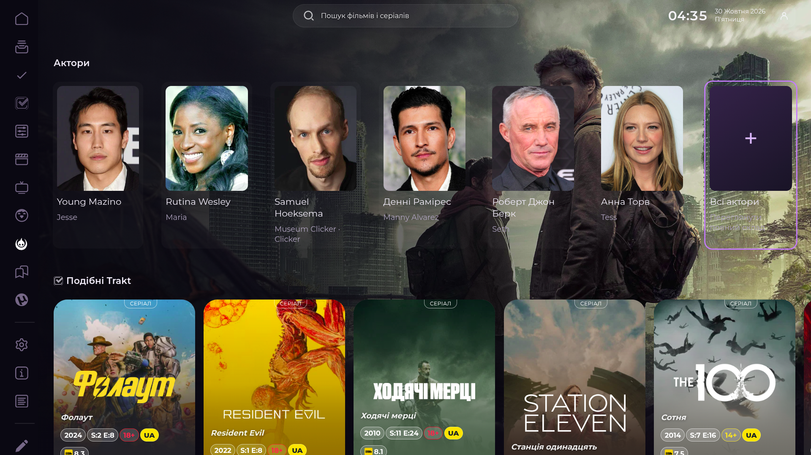
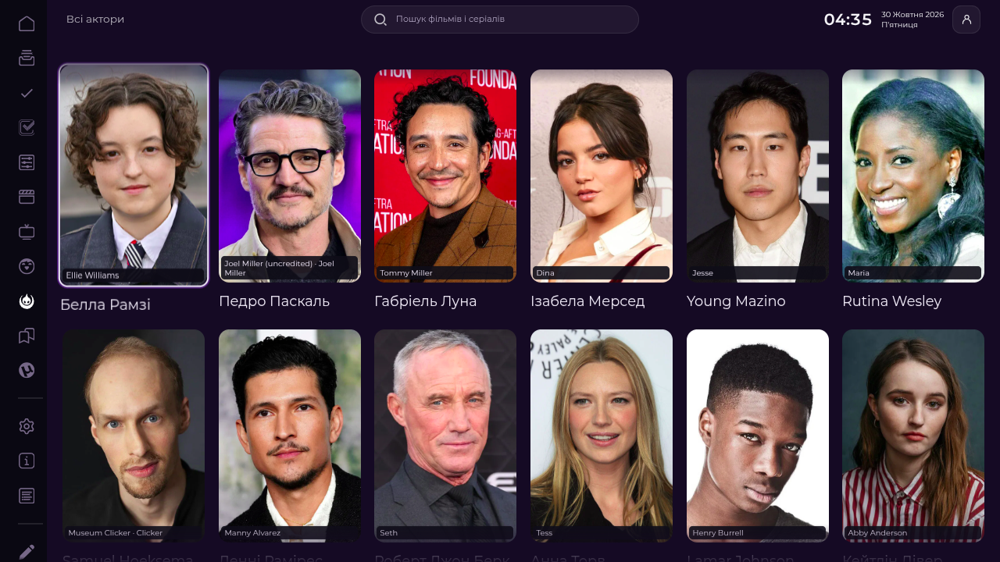

# Issue #87 — Full cast

## Findings

The Last of Us Details route (`card=100088&media=tv`) rendered exactly four people in the native `Full` cast row: Bella Ramsey, Gabriel Luna, Isabela Merced and Young Mazino. The row was not being clipped by CSS: native `Full` received four `data.persons.cast` entries. A read-only request through Lampa's configured TMDb source to `tv/100088/aggregate_credits` returned 159 credited people. The missing actors came from the short native credits payload.

The implementation retains native `Full`, `Person`, `Category` and actor-profile routes. `ui/full-cast.js` runs as a built-in deferred adapter after native `appready`. It leaves the initial Full event synchronous and asks for expanded credits only after the native persons row is built (or when the user opens the full-cast screen). No per-person biography, Trakt or profile requests are issued. Requests coalesce and use a bounded 16-title, six-hour cache.

For the preview it keeps the first ten unique credited people in source order, preserving stable person IDs, portraits and verified characters/aggregate roles. It adds a native-person-style **Всі актори** card when more credits exist or while discovery is pending. The full screen uses native Lampa `Category` pagination in pages of 30; actor Enter opens the native `actor` component. Duplicate IDs are merged without changing first credit order; missing portraits remain missing and use native fallback rendering. Provider errors can be retried from the Category rather than replaced with fabricated data.

The built-in loader lane ensures this Hybrid capability loads even when an installation has a user-selected deferred-plugin list. It does not edit that stored list or enable other plugins. Cast-specific CSS registers under the single Hybrid style owner and retries registration for a bounded interval if a deep-linked Details page reaches the adapter before Hybrid initialization.

## Browser acceptance

Tested in the existing Chrome DevTools Lampa tab (page 3), on the exact local `ui/full-cast.js` source served from loopback; no other browser profile or tab was opened. Native Lampa TMDb transport was used; no synthetic results were injected. The page was The Last of Us (`100088`, TV). Instrumentation observed one `tv/100088/aggregate_credits` request, returning 159 source credits; the full Category rendered 30 cards initially. The first card was Bella Ramsey as Ellie Williams. The focused Pedro Pascal card displayed the aggregate roles returned by TMDb.

Real remote-key actions verified:

1. Right through the native preview to **Всі актори**, then Enter opened `sh_full_cast_grid`.
2. Right/Enter on a person opened the native `actor` route (`id=1253360`, Pedro Pascal).
3. Escape returned to the cast grid with focus on the same Pedro Pascal card.
4. Escape returned to Details with focus on the originating **Всі актори** card.
5. A second Enter from that restored action reopened the grid and started focus on the first cast card.

The full-cast grid contained real source entries and visible role labels. Computed role style was `position:absolute` under the registered Hybrid owner stylesheet. Screenshots were captured in the same tab with DPR 1 at 1280×720 and 1920×1080:

| State | 1280×720 | 1920×1080 |
| --- | --- | --- |
| Before (native four-person preview) |  |  |
| After (ten-person preview and All Actors) |  |  |
| Full native Category |  |  |

Before screenshots show the main branch's four-person native payload. After screenshots show the first ten aggregate credits plus the full-cast action. Full-cast screenshots show the native grid with verified roles. Desktop viewport emulation is not physical Google TV validation.

## Automated coverage

`tests/full-cast.cjs` exercises production handlers for source order, stable IDs, duplicate merging, TV aggregate roles, movie character/animated voice credits, missing photographs, small casts, asynchronous enrichment, reused Full activity/data ownership, in-flight request coalescing, cache, retry after provider failure, native Category/actor routes, 30-card paging of a large movie cast, and lazy/non-blocking loading. `tests/loader-critical-parallel.cjs` checks that the built-in deferred adapter is loaded before optional adapters without changing user configuration. Both are included in the repository-checks GitHub Actions workflow.

At initial authoring, focused command:

```sh
node --test --test-timeout=15000 tests/full-cast.cjs tests/loader-critical-parallel.cjs
```

Result: 18/18 passing. Repository checks and the five Actions are reported against the final pushed SHA in the PR.

## Source identity and limits

The final browser-tested `ui/full-cast.js` SHA-256 at capture time was `7523153ca4af8ae1bbb124295a2bd540d05f9dfe9a307a5f55daefbbfd2c5358`; `loader.js` was `beda1cc9ce6bfe5ff44534301285f2685b78ed19f7ac900d8ce15324cbcd972a`. `ui/full-cast.js` did not change after those screenshots. All data came from the configured TMDb provider through native Lampa; the runtime check observed one TV aggregate-credit request. Movie large-cast paging, animated voice credits, a small cast, missing images, and failure/retry are covered by deterministic production-handler fixtures, not claimed as live-provider browser cases.

Physical Google TV remote, other provider failures in production, and movie/animated/small-cast live routes remain **NOT VERIFIED**. The original Silo browser tab is restored after testing; no settings, Trakt data, parser configuration or credentials were changed.
