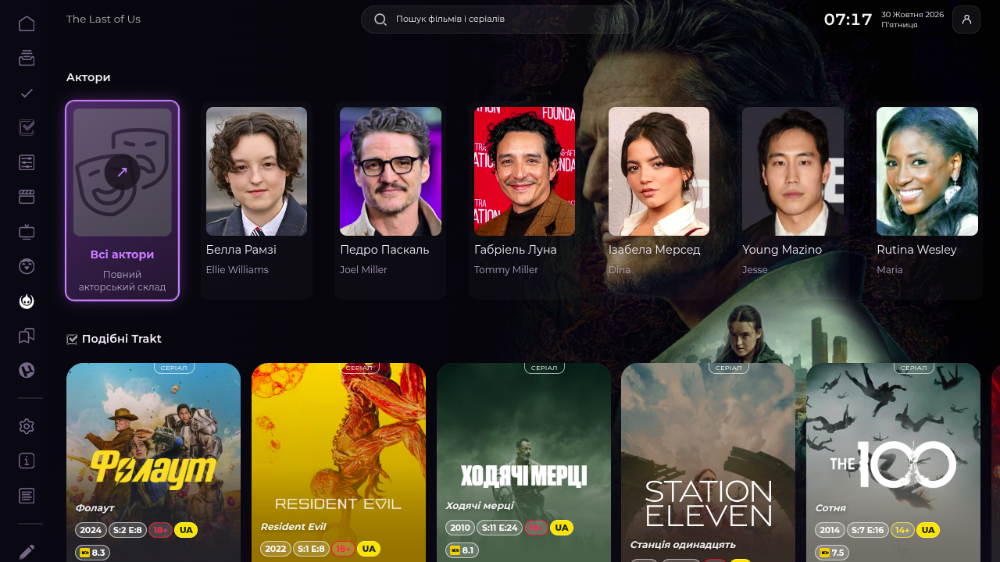
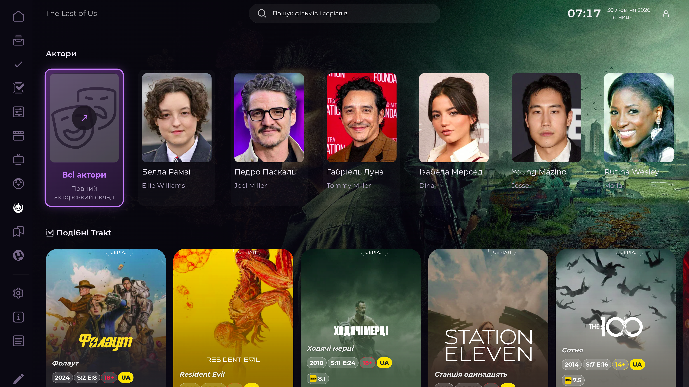
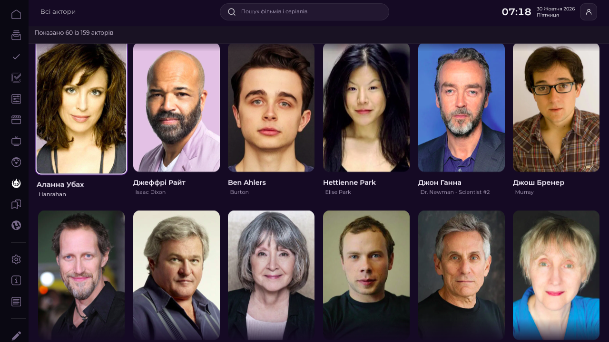
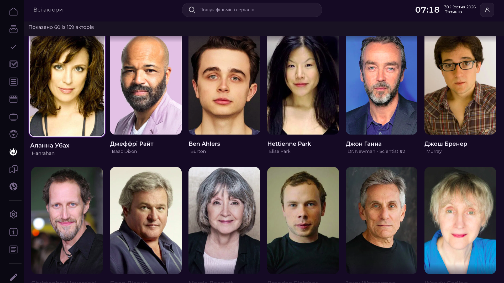

# Issue #87 — Full cast

## Findings and implementation

The Last of Us Details route (`card=100088&media=tv`) initially had four people in native `Full`'s cast row. It was not CSS clipping: the native payload itself contained four entries. The configured TMDb source returned 159 aggregate TV credits for `tv/100088/aggregate_credits`.

The implementation retains native Lampa `Full`, `Person`, and `Category` routes. Details stays synchronous; expanded credits load only when the cast row is built or the user opens the full screen. Requests coalesce and use a bounded 16-title, six-hour cache scoped by `kind:id:tmdb_lang`. No biography, Trakt, or per-person profile requests are made.

The preview preserves the first ten unique credited people, stable TMDb IDs, portraits, credit order, and verified characters/aggregate roles. It adds exactly one native **Всі актори** action as the first item in the existing `Актори` row. Moving Down into that row reaches the action immediately; there is no duplicate heading action or need to traverse the actor carousel. Actor names and role captions use separate card text space; role captions do not cover faces. Equivalent aggregate role captions are deduplicated without merging distinct roles.

The full screen uses the native Lampa `Category`, in pages of 30. Actor Enter opens the native `actor` route. Missing portraits remain in the cast with native fallback artwork. Loading, empty-source, provider-error, retry, and completion states are visible. Retry remains a native Category card action.

The built-in adapter only modifies Details when `StremioHybrid.ownsPresentation('details')` is true. Its CSS registers with the existing Hybrid style owner. It supports a deep-linked `Full` route and delayed Hybrid initialization without modifying the saved plugin list.

## Independent review hardening — 2026-10-30

`replaceCastLine()` now restores focus only when the current Full Activity and Hybrid own the Details screen and the native `items_line` controller currently owns a focused card inside that row. It checks again after the synchronous native row replacement, immediately before `collectionSet` and `collectionFocus`; a new Select/other controller owner prevents focus mutation. Tests resolve pending credits while Select, Torrent Cinema, modal, unrelated Activity, and a controller changed during row replacement are active.

The category pagination metadata reports page 1 on the first batch and page 2 onward accurately. Production-handler tests cover 159 cards in six ordered native batches (30/30/30/30/30/9); the fixture has 158 portrait paths and retains one missing portrait as fallback. The same tests verify loading, empty results, provider failure, reachable retry, and a successful retry.

## Paging and action acceptance — PR #137 final pass

The live paging failure was in the native Category gate, not the credits source. The grid built page 1 for display but left `Category.object.page` undefined. Native `onLoadNext` compares that field with `total_pages`, so `scroll.onEnd` could never advance. The adapter now initializes `object.page = 1` before the native first build and continues using native `onLoadNext`, `build`, Category scroll ownership and the same result set. Progress is pinned visibly inside the active Category and reports the currently rendered count.

The **Всі актори** preview entry is still one native `.full-person` action. Its styles now target `.full-person__photo`, `.full-person__body`, `.full-person__name`, `.full-person__role`, and the native `.focus` class. The icon overlays the portrait placeholder; the label and role remain below the photo. A complete source of at most ten people removes the now-redundant action. Cached complete credits are applied when the same Details owner returns after a response received under another Activity.

Exact-source Chrome acceptance used the existing page 3 and source SHA `f150b5f7f49dc270f4c9e1c5790a87fb9228340b76c8f858ddcb82d8138f4039` (Full Cast source v1.0.5):

- The Last of Us (`tv/100088`) returned 159 live aggregate credits. Native remote navigation advanced the **active Category** from 30 to 60, then 90, then through 120 and 150 to 159. The active Category reached native page 6/6; all 159 source person IDs were unique. The displayed count reached `Показано 159 із 159 акторів`. Counts were read from the active Category, not hidden Activities.
- Arrow navigation selected the actual 31st person, Alanna Ubach (TMDb 10402, Hanrahan). Enter opened that native actor profile; Back restored actor 31, page 2 and its position. Further remote navigation reached actor 60 as page 3 loaded and actor 61 (Yayu Unru, TMDb 1645600). The final batch was reachable by D-pad.
- From the native Details stack, Back from Full Cast restored Details with exactly the originating All Actors action focused. (A separate Escape trial from a deep-linked `Activity.replace` route had no Details beneath it; native Select appeared, and was dismissed without changing a selection. The acceptance route was repeated using Details → All Actors so Back ownership was tested with its proper parent.)
- Fight Club (`movie/550`) had 75 live movie credits. Its active Category also advanced through pages to 75 using remote navigation, with actor profile and exact Back restoration previously verified on the same source version before the final status-background-only adjustment. The Last of Us final action card was inspected at 720p/1080p/4K DPR1; 4K is viewport emulation, not hardware acceptance.
- Native action computed style showed one `.full-person.sh-full-cast-open-card`, the arrow on `.full-person__photo:after`, label/role on their native nodes, and the native focus treatment. No second button or navigation controller was added.

Live visible states are captured in `screenshots/pagination-6513764119/`. Page 1/2 and action evidence are saved. Page 3, final 159 count and intermediate 60/90/120/150 counts were confirmed by live DOM/controller state while navigating; no screenshot is claimed for those unsaved intermediate states. Native Category retains its normal viewport DOM window, so a query over the whole document is not used as an active-page count.

## Browser acceptance

Used the existing Chrome DevTools Lampa tab (page 3), with the local source served from `http://127.0.0.1:8767/full-cast.js`; the final pagination/action browser pass used v1.0.5 SHA `f150b5f7f49dc270f4c9e1c5790a87fb9228340b76c8f858ddcb82d8138f4039`. No browser profile, storage, settings, Trakt history, parser configuration, or torrent state was changed. Page count remained unchanged. At wrap-up, page 3 was returned to its observed initial The Last of Us Full Cast page-1 URL and 1920×1080 DPR1 viewport.

The final PR acceptance pass and full D-pad page progression are recorded above. This supersedes the earlier review pass that had stopped at the first page. Native Category virtualization retains its normal viewport DOM window; cumulative retained DOM/image growth beyond that window is **NOT VERIFIED**. Physical Google TV remains **NOT VERIFIED**.

### Screenshots

Earlier before/after captures are retained here:

| State | 1280×720 | 1920×1080 |
| --- | --- | --- |
| Before (native four-person payload) |  |  |
| After (cast preview) |  |  |

Final review pass (DPR 1):

| View | 1280×720 | 1920×1080 | 3840×2160 |
| --- | --- | --- | --- |
| The Last of Us — focused full-cast action |  |  | — |
| The Last of Us — focused actor card |  |  |  |
| Fight Club — focused native card |  |  |  |
| Fight Club — focused cast action | — |  | — |

The 4K screenshots are desktop viewport emulation at DPR 1. They are not physical television acceptance.

Pagination hardening captures (DPR 1):

| State | Screenshot |
| --- | --- |
| Native All Actors action at 720p |  |
| Native All Actors action at 1080p |  |
| Native All Actors action at 4K viewport |  |
| TLOU page-1 visible progress |  |
| TLOU page-2 actor 31 focused at 720p |  |
| TLOU page-2 actor 31 focused at 1080p |  |

## Automated coverage

`tests/full-cast.cjs` covers actual production handlers: source order and IDs, duplicate people/roles, TV and movie credits, voice roles, missing portraits, small casts, deep-link recovery, Hybrid disabled/delayed ownership, language cache partitioning, controller ownership races, retry/empty/loading states, actor routes, and six-page 159-person pagination. `tests/loader-critical-parallel.cjs` verifies built-in deferred adapter ordering without modifying user preferences.

Focused command:

```sh
node --test --test-timeout=15000 tests/full-cast.cjs tests/loader-critical-parallel.cjs
```

Latest local result before final delivery: 30/30 passed. Repository checks passed. Final GitHub Actions status and exact pushed SHA are recorded in the PR after final push.
