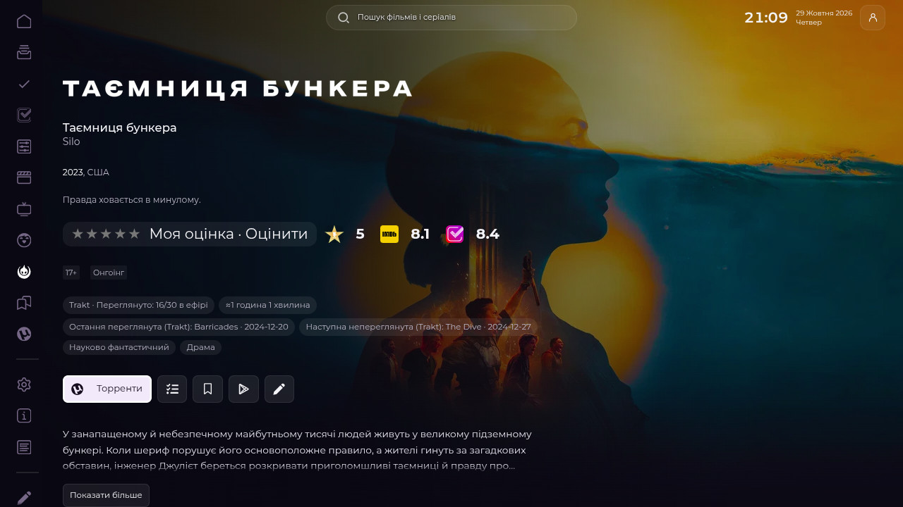
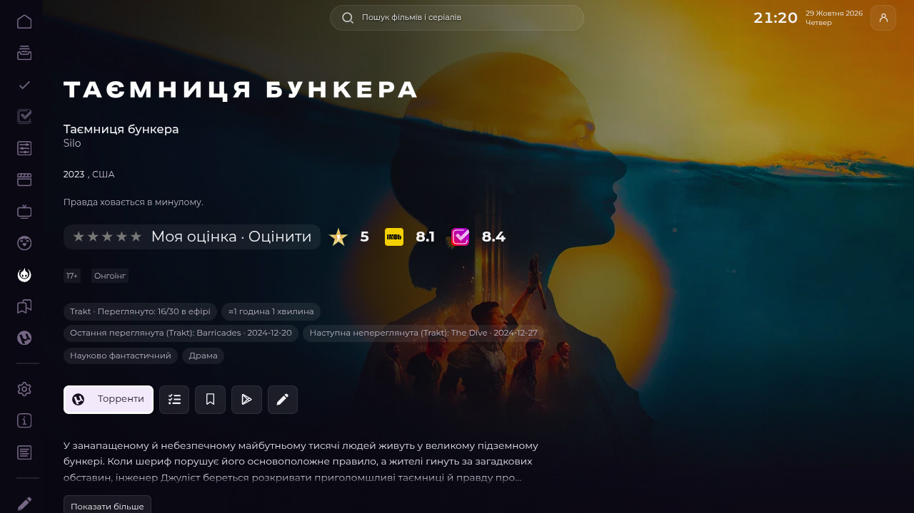
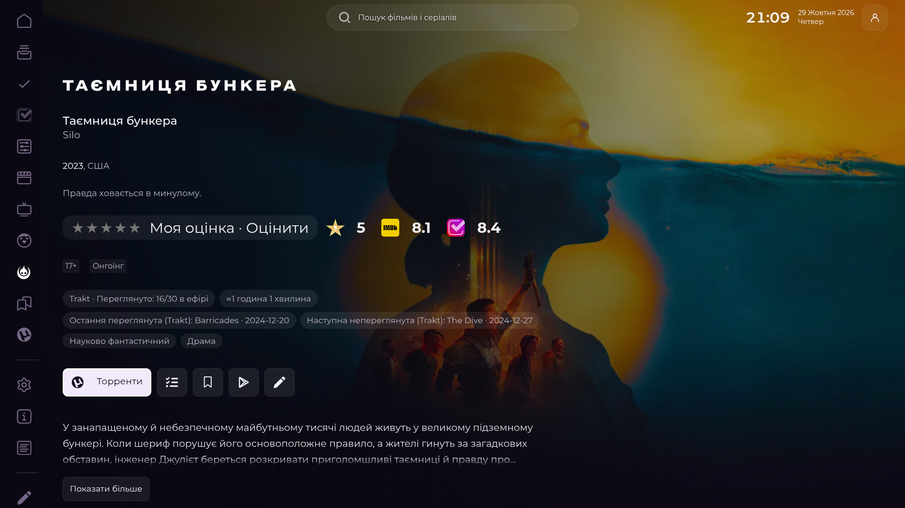
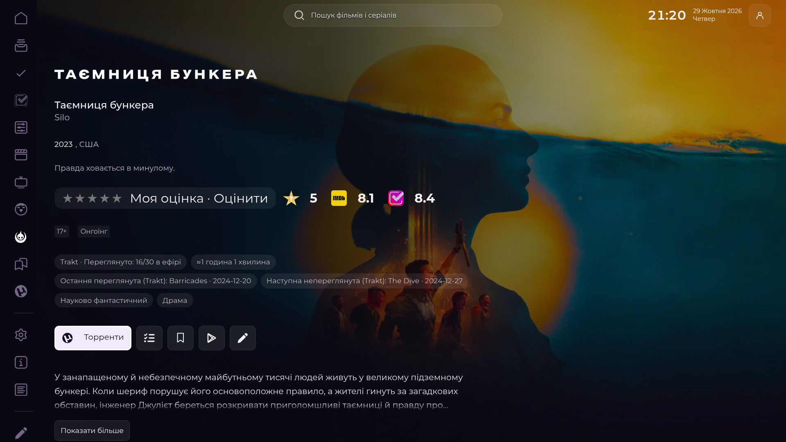
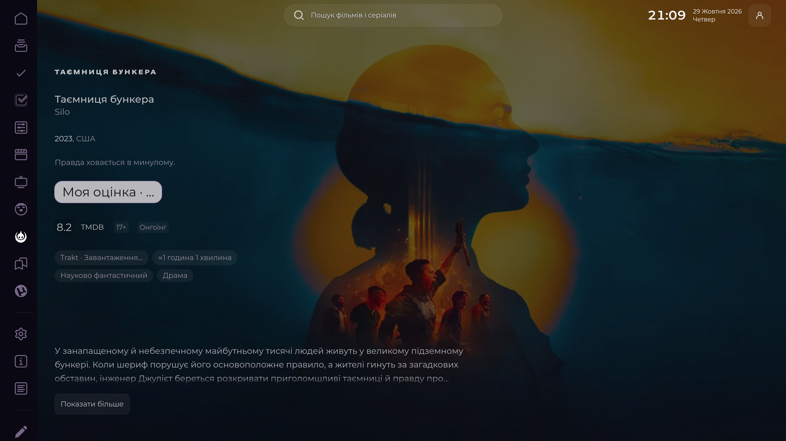
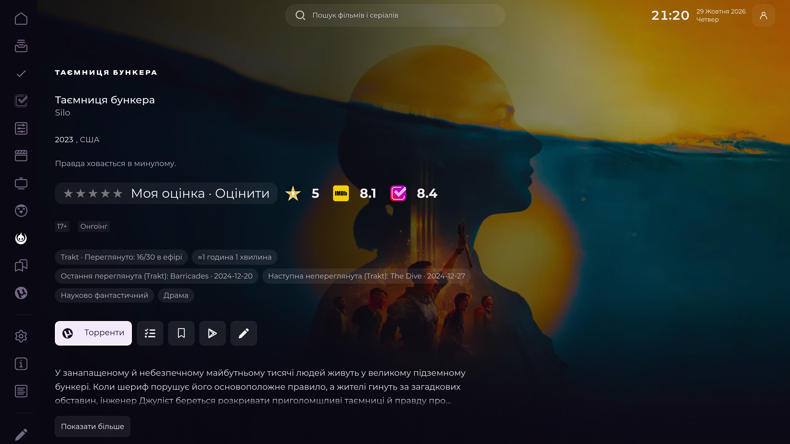

# Issue #89 Details page evidence

## Scope

The Hybrid Details adapter keeps Lampa's native movie, TV, genres, comments, studio/network, related-list, and episode nodes. It moves existing nodes with their listeners rather than cloning them. The episode preview and native season/episode renderer remain intact.

The page now renders three matching disclosure rows in this order: **Коментарі** (open by default), **Студії та виробництво**, and **Додаткова інформація**. The native “Детально” heading is hidden while those rows are active. Genre labels are descriptive only; the existing shared native **Жанр** selector remains the sole genre-filter action. “Пов'язані списки” and the existing genre/keyword controls live inside “Додаткова інформація”. Disabling/restarting Hybrid restores the original nodes, positions, handlers, and classes.

## Main Chrome browser acceptance

Tested in the existing connected Chrome DevTools session on the Silo TV Details route:

`https://siaivo.isroot.in/?card=125988&media=tv&source=tmdb`

The exact branch `ui/stremio-hybrid.js` bytes were injected reversibly into the existing page. The main Chrome was not replaced and no Storage, extension settings, parser settings, credentials, or Trakt data were changed.

- Actual D-pad/OK opened and closed the comments disclosure; focus stayed on its toggle.
- The shared native Genre control inside Additional Information opened Lampa's native Select; Escape returned focus to the invoking control.
- The duplicate “Детально” heading was absent; the episode preview remained one native row.
- The related-lists control was inside the collapsed Additional Information section.
- At 1280×720, 1920×1080, and 3840×2160 CSS viewport with DPR 1, all three disclosure rows had identical left edge and width, and document horizontal overflow was false.
- At initial page reload, the native `full_start` controller focused “Торренти”.
- The original URL and viewport (1920×937, DPR 1) were restored after testing.

The before screenshot shows the native page while optional comments were still in its loading state. The after screenshot shows the same route after the configured comment source returned real comments; this is visual evidence, not a controlled provider-content comparison.

| State | Screenshot |
| --- | --- |
| Main before | [details-before-1920x1080.png](details-before-1920x1080.png) |
| Issue #89 branch after | [details-after-1920x1080.png](details-after-1920x1080.png) |

## Limits

Physical Google TV remote/hardware acceptance has not been performed. Browser viewport emulation does not prove device rendering. This initial acceptance used the Silo TV route; the focused follow-up below adds a real movie route.

## Focused UX/correctness follow-up — 2026-10-29

The final branch source (`ui/stremio-hybrid.js` SHA-256 `3a623cf617cc9c659b2f1e295a25020be9b1fc7d203d7abf8c2104f0fe7196ac`) keeps the native Lampa Scroll owner in control. After native Arrow navigation, the adapter now calls the active Full Details component's `scroll.immediate(focused)` in one animation frame. A prior attempt to call DOM `scrollIntoView()` did not work reliably because Lampa's managed scroll position subsequently replaced it; that approach was removed. All three rows use one restrained circular chevron treatment and the existing high-contrast TV focus outline.

On the existing main Chrome page, exact local `ui/stremio-hybrid.js` bytes were loaded reversibly. The live TV route was `?card=125988&media=tv&source=tmdb` (Silo), and the movie route was `?card=1384216&media=movie&source=tmdb` (The Dog Stars). Actual remote-key behavior:

- On both routes, the initial native focus remained **Торренти**. The movie rendered no season controls.
- Three delayed `Lampa.Listener.send('full')` adaptations retained the same connected native Genre control inside Additional Information and preserved its focus.
- ArrowDown reached Comments and its first comment card. The focused comment card was inside the viewport after native scrolling (movie at 1920×1080: y=131..362; Silo at 3840×2160: y=436..810).
- Enter opened/collapsed each disclosure. Escape collapsed the focused open disclosure and left Details active. From Genre, Enter opened Lampa's actual native Select; Escape closed Select and restored focus to the exact originating Genre control, then another Escape collapsed Additional Information.
- The comments source and content were real page data; no fixture or DOM-only replacement was used. No Storage, credentials, Trakt history or saved preferences were changed.

### Alignment geometry

The disclosure group is a child of `.full-start-new` and uses its content width. It no longer uses the fixed negative-left/extra-width workaround. Measurements are CSS pixels at DPR 1, comparing disclosure-group edges with the parent content box:

| Viewport | Left edge delta | Right edge delta | Horizontal overflow |
| --- | ---: | ---: | --- |
| 1280×720 | −0.014 px | +0.014 px | No |
| 1920×1080 | −0.014 px | +0.014 px | No |
| 3840×2160 | −0.011 px | +0.011 px | No |

### Same-state TV screenshots

Before/after screenshots below use the same Silo route, initial Torrent focus, native top scroll position, loaded media content and DPR 1. The 4K images are actual 3840×2160 browser captures. Movie before/after images use the same The Dog Stars route and 1920×1080 viewport; the additional movie screenshot shows the open Comments row and native comment carousel.

| View | Before | Branch after |
| --- | --- | --- |
| 1280×720 |  |  |
| 1920×1080 |  |  |
| 3840×2160 |  |  |

Movie comparison: [before](acceptance-2026-10-29/movie-before-1920x1080.jpg), [after](acceptance-2026-10-29/movie-after-1920x1080.jpg), [open Comments](acceptance-2026-10-29/movie-comments-after-1920x1080.jpg).

The main tab will be returned to its original Silo URL and 1920×937 viewport after verification. Physical Google TV acceptance remains outstanding.
